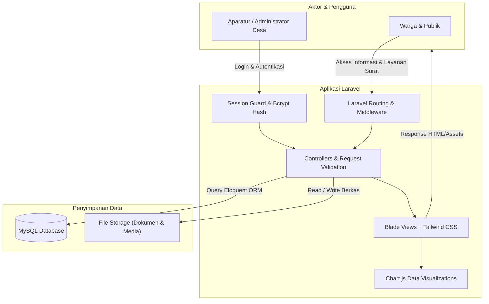

<div align="center">

# 🏛️ Website Resmi Desa Kupal
### Sistem Informasi Desa (SID) & Portal Pelayanan Publik Terpadu

[](https://laravel.com)
[](https://www.php.net)
[](https://tailwindcss.com)
[](https://www.mysql.com)
[](LICENSE)

<p align="center">
  Solusi digital modern untuk tata kelola pemerintahan desa, transparansi anggaran publik (APBDes), demografi penduduk interaktif, dan layanan administrasi mandiri bagi masyarakat desa.
</p>

</div>

---

## 📑 Daftar Isi
- [Gambaran Umum](#-gambaran-umum)
- [Arsitektur Sistem](#-arsitektur-sistem)
- [Fitur Utama](#-fitur-utama)
  - [1. Portal Publik (Frontend Warga)](#1-portal-publik-frontend-warga)
  - [2. Panel Administrator (Backend)](#2-panel-administrator-backend)
- [Tech Stack](#-tech-stack)
- [Petunjuk Instalasi & Menjalankan](#-petunjuk-instalasi--menjalankan)
- [Kredensial Pengembangan (Development)](#-kredensial-pengembangan-development)
- [Struktur Direktori](#-struktur-direktori)
- [Keamanan & Produksi](#-keamanan--produksi)
- [Kontributor & Lisensi](#-kontributor--lisensi)

---

## 💡 Gambaran Umum

**Website Resmi Desa Kupal** dikembangkan untuk mendigitalkan birokrasi pemerintahan desa dan mempercepat arus informasi kepada masyarakat. Sistem ini menggabungkan portal publik yang informatif dengan sistem manajemen konten (CMS) dan panel administrasi yang dirancang khusus untuk aparatur desa.

Dengan integrasi visualisasi data **Chart.js** dan desain responsif berbasis **Tailwind CSS**, portal ini memudahkan warga mengakses data transparansi APBDes dan demografi secara real-time dari perangkat desktop maupun ponsel cerdas.

---

## 🏗 Arsitektur Sistem



---

## 🚀 Fitur Utama

### 1. Portal Publik (Frontend Warga)
* **Beranda Interaktif:**
  * *Hero Slider Carousel* responsif untuk sorotan kegiatan dan program desa.
  * Sambutan resmi Kepala Desa Kupal.
  * Ringkasan cepat statistik kependudukan dan transparansi anggaran tahun berjalan.
  * *Running Ticker* pengumuman dinamis bergerak di header portal.
  * Berita terkini dilengkapi penghitung pembaca (*views counter*).
* **Profil Desa Lengkap:**
  * Visi & Misi pembangunan desa.
  * Narasi sejarah berdirinya Desa Kupal dan keterkaitan dengan Kesultanan Bacan.
  * Batas administratif (Utara, Selatan, Barat, Timur) serta integrasi Google Maps interaktif.
* **Pemerintahan & SOTK:**
  * Struktur Organisasi dan Tata Kerja aparatur desa lengkap dengan bagan hierarki dan foto resmi.
* **Infografis & Transparansi Publik:**
  * **Demografi Kependudukan:** Grafik interaktif Chart.js berdasarkan jenis kelamin, kelompok usia, tingkat pendidikan, status perkawinan, dan agama.
  * **Transparansi APBDes:** Donut chart visualisasi sumber pendapatan (PAD, Dana Desa, dll.) serta rincian kegiatan belanja tahunan.
* **Layanan Mandiri & Aspirasi Warga:**
  * Pengunduhan blanko surat resmi (SKTM, Surat Domisili, SKU, Pengantar KTP).
  * Kotak Aspirasi publik terlindung dari CSRF token.
* **Galeri Media:**
  * Galeri foto dengan pratinjau *lightbox modal* dan integrasi pemutar video YouTube responsif.

---

### 2. Panel Administrator (Backend)
* **Autentikasi Aman:** Sistem otentikasi berbasis *session guard* khusus admin dan password hash `bcrypt`.
* **Dashboard Metrik:** Kartu statistik total berita, jumlah penduduk, dokumen layanan terunggah, serta notifikasi saran masuk.
* **Manajemen Konten (CRUD):**
  * Kelola Berita, Artikel, dan Kategori dengan editor konten lengkap dan upload thumbnail.
  * Kelola Banner Slider, Pengumuman Ticker, dan Profil Pimpinan.
  * Kelola Data Demografi & Aggregat Penduduk secara instan.
  * Kelola Alokasi Anggaran APBDes per tahun anggaran.
  * Kelola Arsip Berkas Blanko Layanan Masyarakat.
  * Kelola Kotak Aspirasi & Tanggapan Warga.
  * Manajemen Hak Akses Pengguna (*Administrator Management*).

---

## 🛠 Tech Stack

| Lapisan | Teknologi |
| :--- | :--- |
| **Framework Backend** | [Laravel 11 / 12](https://laravel.com) |
| **Bahasa Pemrograman** | PHP 8.2+ |
| **Styling & UI** | [Tailwind CSS](https://tailwindcss.com) / Blade Template Engine |
| **Database** | MySQL / MariaDB |
| **Visualisasi Data** | [Chart.js](https://www.chartjs.org/) |
| **Server Lokal** | Apache (XAMPP) / Laravel Artisan |
| **Version Control** | Git & GitHub |

---

## ⚙️ Petunjuk Instalasi & Menjalankan

### Prasyarat:
* PHP >= 8.2 (dengan ekstensi `pdo_mysql`, `mbstring`, `fileinfo`, `gd`)
* Composer
* Node.js (>= 18) & npm
* XAMPP (Apache & MySQL) atau server lokal sejenis

### Langkah Instalasi:

1. **Clone Repositori:**
   ```bash
   git clone https://github.com/owensavala/web-desa-laravel.git
   cd web-desa-laravel
   ```

2. **Install Dependensi Composer & Node:**
   ```bash
   composer install
   npm install
   ```

3. **Konfigurasi Environment:**
   Salin file `.env.example` menjadi `.env`:
   ```bash
   cp .env.example .env
   ```
   Buka file `.env` dan sesuaikan koneksi database Anda:
   ```env
   DB_CONNECTION=mysql
   DB_HOST=127.0.0.1
   DB_PORT=3306
   DB_DATABASE=web_desa_laravel
   DB_USERNAME=root
   DB_PASSWORD=
   ```

4. **Generate Application Key:**
   ```bash
   php artisan key:generate
   ```

5. **Migrasi Database & Seeder Data Awal:**
   Jalankan migrasi tabel beserta data demo Desa Kupal:
   ```bash
   php artisan migrate --seed
   ```
   *(Atau jalankan seeder khusus: `php artisan db:seed --class=DesaKupalSeeder`)*

6. **Buat Symlink Storage:**
   Pastikan berkas foto dan dokumen publik dapat diakses:
   ```bash
   php artisan storage:link
   ```

7. **Jalankan Aplikasi:**
   Kompilasi asset frontend dan jalankan server pengembangan:
   ```bash
   # Di terminal 1:
   npm run dev

   # Di terminal 2:
   php artisan serve
   ```
   Aplikasi siap diakses di browser:
   * **Portal Warga:** `http://localhost:8000`
   * **Panel Administrator:** `http://localhost:8000/admin/login`

---

## 🔐 Kredensial Pengembangan (Development)

Untuk lingkungan pengembangan lokal setelah menjalankan seeder bawaan (`DesaKupalSeeder`):

| Role | Username Bawaan | Catatan |
| :--- | :--- | :--- |
| **Administrator Utama** | `admin` | Diset melalui seeder database lokal |
| **Administrator Staf** | `sattar` | Diset melalui seeder database lokal |

> ⚠️ **Penting untuk Lingkungan Produksi:** Segera ganti seluruh kata sandi bawaan melalui menu **Kelola Administrator** sebelum mempublikasikan sistem ke hosting atau VPS publik.

---

## 📂 Struktur Direktori

```text
web-desa-laravel/
├── app/
│   ├── Http/Controllers/       # Controller web publik & panel admin
│   ├── Models/                 # Model Eloquent (Berita, Warga, APBDes, dll.)
│   └── Providers/              # Service providers
├── database/
│   ├── migrations/             # Skema migrasi database
│   └── seeders/                # Seeder data awal Desa Kupal
├── public/                     # Entry point (index.php) & aset statis
├── resources/
│   ├── views/                  # Template Blade (layout, publik, admin)
│   ├── css/                    # Tailwind CSS styles
│   └── js/                     # Skrip JavaScript & Chart.js setup
├── routes/
│   ├── web.php                 # Rute utama aplikasi
│   └── console.php             # Rute CLI artisan
└── tests/                      # Suite pengujian otomatis
```

---

## 🔒 Keamanan & Praktik Terbaik
* Seluruh form mutasi data dilindungi dari serangan **CSRF** menggunakan token otomatis Laravel.
* Upload berkas dan dokumen divalidasi ketat pada tipe MIME dan batas ukuran file.
* Password pengguna dienkripsi dengan standar hash industri `bcrypt`.
* Input pengguna disanitasi untuk mencegah injeksi SQL melalui Laravel Eloquent Query Builder.

---

## 👨‍💻 Kontributor

* **Muh. Sattar Barakati** ([@owensavala](https://github.com/owensavala)) - *Lead Developer*

---

## 📄 Lisensi

Proyek ini dilisensikan di bawah [MIT License](LICENSE) - bebas digunakan dan dikembangkan untuk kepentingan publik dan pemerintahan desa.
